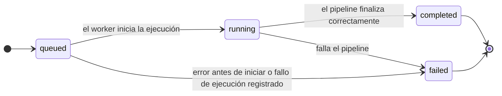
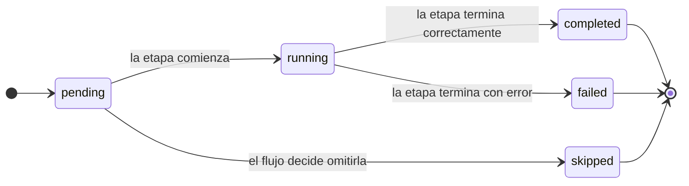
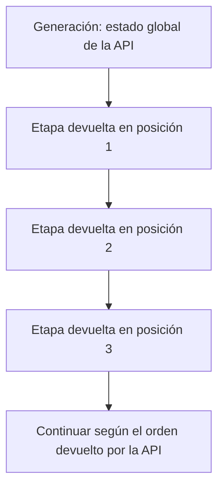

# Fase 1.5 — Conectar `GenerationPage` al backend

Etapa de **transición** entre la Fase 1 (backend con las rutas de `generations` y Supabase, ya
verificado) y la Fase 2 (documentos y resultados). Su alcance es **todo lo relacionado con
`generation`**, usando **exclusivamente** los endpoints que existen hoy en el código.

Este documento es el **plan operativo de implementación** de la Fase 1.5. `indicaciones.md` se
conserva como **inventario de hallazgos y evidencia de la revisión inicial**; no se elimina ni se
reescribe como parte de esta tarea. Las discrepancias detectadas se resumen en §4. Si ambos
archivos difieren, usa este plan para el orden y alcance de implementación, pero verifica los hechos
contra el código actual y `docs/openapi.yaml`: ningún documento sustituye esa verificación.

> Baseline verificado antes de escribir este documento:
> `venv\Scripts\python -m pytest` → **41 passed** · `npx tsc --noEmit -p tsconfig.app.json` →
> **0 errores** · `npx eslint .` → **0 problemas**.

**Convenciones del documento**

- Las rutas del backend son relativas a `backend/` (por ejemplo `ai_service/main.py`); las del
  frontend, relativas a `frontend/`. Ajusta el prefijo si tu raíz es distinta.
- Las referencias a código usan **archivo → símbolo**, no números de línea: esta fase edita esos
  mismos archivos y las líneas se desactualizarían de inmediato.
- Lo marcado **(a verificar)** no se pudo confirmar al redactar el documento; el agente debe
  comprobarlo en el código antes de implementar y reportar el resultado.

---

## 1. Mapa de carpetas: qué se toca y qué no

| Zona | Carpeta | ¿Se modifica en la 1.5? |
|---|---|---|
| **Backend** | `backend/ai_service/api/` (`errors.py`) | **Sí** (§5.1) |
| **Backend** | `backend/ai_service/main.py`, `backend/ai_service/config.py` | **Sí** (§5.2) |
| **Backend** | `backend/tests/` | **Sí**, solo pruebas nuevas (§5.3) |
| **Backend** | `backend/.env.example` | **Sí** (§5.2) |
| **Backend** | `backend/ai_service/{services,repositories,pipeline,schemas,clients,core}/` | **No** (lógica de la Fase 1 ya verificada) |
| **Backend** | `backend/supabase/` | **No** |
| **Docs** | `README.md`, `docs/openapi.yaml` | **Sí**, solo 2 códigos de error (§5.4) |
| **Frontend** | `frontend/src/shared/api/` | **Sí**, carpeta nueva (§6.2) |
| **Frontend** | `frontend/src/shared/{types.ts,hooks/useAsyncData.ts,components/}` | **Sí** (§6.3, §6.4) |
| **Frontend** | `frontend/src/features/generation/**` | **Sí** (§6.5 a §6.9) |
| **Frontend** | `frontend/src/app/{routes.tsx,paths.ts}` | Solo si hace falta (a verificar) |
| **Frontend** | `frontend/{vite.config.ts,.env.example,.env,.gitignore,package.json}` | **Sí** (§6.2, §6.10) |
| **Frontend** | `frontend/src/features/history/**` | **No** (queda con mocks) |
| **Frontend** | `frontend/src/features/metrics/**` | **No** |
| **Frontend** | `frontend/src/features/comparison/**` | **No** |

> Regla de cierre: `features/history`, `features/metrics` y `features/comparison` deben seguir
> compilando y funcionando con sus mocks. Si un cambio compartido obliga a tocarlos, se lista
> y se justifica en la entrega; no se hace en silencio.

---

## 2. Decisiones adoptadas

| # | Decisión | Detalle |
|---|---|---|
| D1 | **Proxy en desarrollo y CORS en el backend cuando corresponda** | El proxy de Vite evita CORS en el flujo local same-origin. FastAPI configura CORS para los orígenes reales que accedan directamente a la API desde el navegador (por ejemplo, frontend y backend desplegados en dominios distintos). Los orígenes son configurables por entorno; nunca usar `*` como lista de orígenes. El frontend no configura CORS. |
| D2 | **No se implementa el upload** | No existe `POST /documents`. El `File` del formulario no se envía; se usa el `document_id` del seed, leído de `VITE_DEV_DOCUMENT_ID`, y la interfaz **avisa** de ello. |
| D3 | **Sí se implementa `POST /generations`** | Con el documento del seed (`6f9d1c2e-0a4b-4c8d-9e1f-2b3c4d5e6f70`). |
| D4 | **Contrato de etapas propiedad del backend** | La API es la fuente de verdad para `key`, `name`, `order` y `status` de las etapas. La UI conserva las claves y estados recibidos; un adaptador/catálogo de presentación separado define etiquetas en español, descripciones e iconos. No duplicar nombres técnicos ni inventar etapas. |
| D5 | **Tests mínimos de frontend (propuesta)** | Vitest solo para piezas puras y el polling (§6.10). Si se rechaza, el checklist manual de §8 es el único respaldo y los bugs B1/B2 deben vigilarse a mano. |
| D6 | **`StageStatus` separado de `ExecutionStatus`** | `skipped` solo existe para etapas. `ExecutionStatus` (generación) no cambia, así que `features/history` no se toca. |
| D7 | **Errores 404/405 estándar en el backend** | Se corrige la causa (manejador de `StarletteHTTPException`) y además el cliente HTTP tolera respuestas fuera de formato. |
| D8 | **`summary` es `null`** | La UI muestra «—» donde esperaría conteos HU/RF/CP. Nunca ceros. |
| D9 | **Polling robusto y estados diferenciados** | El backend es la fuente de verdad del estado de la generación. Un `failed` de la API significa fallo de ejecución; un error de transporte no significa que el pipeline haya fallado. Usar temporizador encadenado, reintentos acotados, cancelación y recuperación manual. |
| D10 | **Un solo seguimiento activo** | «Iniciar» se deshabilita mientras la generación seguida está en `queued` o `running`. El límite de concurrencia del backend sigue pendiente de definición. |
| D11 | **Mocks compartidos con historial no se borran** | `stageDefinitions`, `buildMockStages` y mocks de historial se dejan de usar en `GenerationPage`, pero se eliminan solo si ningún otro consumidor los importa (a verificar). |
| D12 | **Nombres `Execution*` se mantienen** | Renombrar a `Generation*` queda para la Fase 2. |

---

## 3. Alcance

### 3.1. Endpoints consumidos (todos existen hoy)

| Método | Ruta | Uso en la 1.5 |
|---|---|---|
| GET | `/api/v1/health` | Comprobación de arranque |
| POST | `/api/v1/generations` | Botón «Iniciar» (202) |
| GET | `/api/v1/generations?limit=&offset=` | Ejecuciones recientes y rehidratación tras recarga |
| GET | `/api/v1/generations/{id}` | Polling de progreso |

**No se usan:** `DELETE /generations/{id}` (no hay UI de borrado en `GenerationPage`),
`GET /generations/{id}/events` (responde 501), ninguna ruta de documentos ni de resultados (no
existen).

### 3.2. Fuera del alcance

`features/history/**`, `features/metrics/**`, `features/comparison/**`, rutas de documentos,
rutas de resultados, SSE y descargas. Inventario en §9.

---

## 4. Incidencias detectadas en `indicaciones.md`

### 4.1. Hechos incorrectos

| # | Dice | Real |
|---|---|---|
| I1 | `useExecutionPipeline` «no se usa en ninguna pantalla» | **Sí se usa**: `ExecutionPipeline` lo invoca y se renderiza en `ExecutionDetailPage` (ruta `/history/:executionId`). Lo correcto es que `GenerationPage` no lo usa. |
| I2 | «Ver detalle» con botón deshabilitado | El botón de `RecentExecutionsCard` no tiene `disabled`; llama a `handleViewDetails` en `GenerationPage`, que está vacío. |
| I3 | Errores «siempre» con formato `{"error": {...}}` | Falso para rutas desconocidas: `GET /api/v1/nope` → `404 {"detail":"Not Found"}`. `StarletteHTTPException` no está cubierta en `api/errors.py`. **Se corrige en §5.1.** |
| I4 | `FASE1.md:3017` | La línea real es la 3024. |
| I5 | Rama actual `generador-backend` | La rama actual es `backend`. La lista de `.pyc` huérfanos estaba incompleta (§9.2). |
| I6 | Referencias de línea con deriva | Varias líneas citadas estaban desplazadas. Por eso este documento usa símbolos, no líneas. |

### 4.2. Nombres diferentes no contemplados

| # | Tema | Detalle |
|---|---|---|
| I7 | **Modelo de etapas incompatible** | El frontend define 5 etapas (`document-processing`, `requirements-extraction`, `semantic-grouping`, `test-generation`, `evaluation`), una de ellas condicional (`utils/stageDefinitions.ts`); el backend devuelve 7 fijas `p1..p7` (`pipeline/catalog.py`). Consecuencia: `DEFAULT_EXPANDED_IDS = ['document-processing']` en `GenerationPage.tsx` nunca coincide con `p1`. **Resuelto en §6.7 (D4).** |
| I8 | `configuration` y firmas | Falta mapear `semanticGrouping` ↔ `semantic_clustering_enabled`, `method_type`, `startGeneration` (`{executionId}` → `Generation`) y `listRecentExecutions` (arreglo → `{items, pagination}`). **Resuelto en §6.5.** |
| I9 | Historial (fuera de alcance) | `ExecutionRecord.uploadedAt` vs `created_at`; `ExecutionFailure {stage, message}` vs `error_message` (string único). Deuda para la Fase 2. |

### 4.3. Faltantes documentados de forma incompleta

| # | Tema | Detalle |
|---|---|---|
| I10 | Documentos en el backend | Además de `routes/documents.py` y `services/documents.py`, no existen: `schemas/documents.py`, las excepciones `DocumentInUse`/`PayloadTooLarge`/`UnsupportedMediaType` con sus mapeos 409/413/415, la configuración `MAX_UPLOAD_SIZE_BYTES` y el bucket, ningún uso de Supabase Storage, y `SupabaseDocumentsRepository` solo implementa `get_by_id`. Es trabajo de la Fase 2. |
| I11 | `useStartGeneration` | Es el hook real del formulario de `GenerationPage`; `indicaciones.md` solo citaba `generationService.startGeneration`. |

---

# PARTE BACKEND

Carpetas: `backend/ai_service/api/`, `backend/ai_service/main.py`, `backend/ai_service/config.py`,
`backend/tests/`, `backend/.env.example`, más `README.md` y `docs/openapi.yaml`.
**No se toca** la lógica de generaciones, pipeline, repositorios ni esquemas.

## 5.1. Manejador de errores HTTP del framework (D7)

**Archivo:** `ai_service/api/errors.py` (función donde se registran los manejadores).

- Registrar un manejador para `starlette.exceptions.HTTPException` (la excepción base que lanzan
  el enrutador para 404 y 405; la `HTTPException` de FastAPI hereda de ella).
- Respuesta siempre en el formato estándar `{"error": {"code", "message", "details"}}`:

| Status | `code` | `message` |
|---|---|---|
| 404 | `NOT_FOUND` | El recurso solicitado no existe. |
| 405 | `METHOD_NOT_ALLOWED` | Método no permitido para este recurso. |
| otros | `HTTP_ERROR` | Mensaje genérico seguro (sin detalle interno). |

- Conservar el status original y las cabeceras de la excepción (por ejemplo `Allow` en el 405).
- `HTTP_ERROR` se documenta solo en prosa (README); no se agrega a la tabla de errores porque su
  status varía. El manejador no debe sobrescribir códigos de dominio específicos ya definidos
  (por ejemplo `GENERATION_NOT_FOUND` o `DOCUMENT_NOT_FOUND`).

## 5.2. CORS y configuración

**Archivos:** `ai_service/config.py`, `ai_service/main.py`, `.env.example`.

- Añadir una configuración de orígenes del frontend en `ai_service/config.py` y cargarla desde
  una variable de entorno, por ejemplo `FRONTEND_ORIGINS`. Debe poder configurarse por entorno
  sin modificar el código. Para facilitar el despliegue, documentar una sintaxis clara en
  `.env.example` (preferentemente lista separada por comas, con un parser/validador explícito; si
  el proyecto mantiene el tipo lista nativo de `pydantic-settings`, usar y documentar JSON en su
  lugar, sin mezclar formatos).
- No fijar dominios de producción como valores permanentes en el código. El valor local puede
  tener un default de desarrollo, pero producción debe definir los orígenes reales mediante la
  configuración del entorno de despliegue.
- Registrar `CORSMiddleware` en `ai_service/main.py` con la lista configurada, métodos y cabeceras
  mínimos necesarios, y `allow_credentials=False` mientras no exista un requisito de cookies o
  autenticación basada en credenciales del navegador. No usar `allow_origins=["*"]`.
- CORS se configura **en el backend**, no en el frontend. El navegador solo aplica CORS cuando
  frontend y API son orígenes distintos. En desarrollo, las solicitudes a `/api` a través del
  proxy de Vite son same-origin y normalmente no necesitan CORS. El proxy de Vite no es una
  configuración de producción: si producción llama directamente a otro dominio, FastAPI debe
  permitir el origen del frontend.
- No añadir CORS como una solución al polling: las consultas de polling usan la misma política de
  origen que cualquier otra petición HTTP.
- Sin dependencias nuevas (`fastapi.middleware.cors` ya está instalado).

## 5.3. Pruebas del backend

**Carpeta:** `tests/` (archivo nuevo, por ejemplo `test_http_errors_and_cors.py`).

1. `GET /api/v1/ruta-inexistente` → 404 con `error.code == "NOT_FOUND"` y sin clave `detail`.
2. `POST /api/v1/health` → 405 con `error.code == "METHOD_NOT_ALLOWED"` y cabecera `Allow`, sin
   perder códigos de error de dominio específicos en otras rutas.
3. Preflight `OPTIONS /api/v1/generations` con `Origin: http://localhost:5173` y
   `Access-Control-Request-Method: POST` → respuesta con `access-control-allow-origin` igual al
   origen.
4. Mismo preflight con un origen no permitido → **sin** `access-control-allow-origin`.
5. Las 41 pruebas existentes siguen pasando.

## 5.4. Documentación afectada

- `README.md` §6 (tabla de errores): añadir `404 NOT_FOUND` y `405 METHOD_NOT_ALLOWED`, y una
  línea en prosa sobre `HTTP_ERROR`.
- `docs/openapi.yaml`: añadir `NOT_FOUND` y `METHOD_NOT_ALLOWED` a la lista `examples` de
  `ErrorDetail.code`. No hacen falta respuestas nuevas por operación (son rutas no definidas).
- Si conservas `check_docs.py`, ejecútalo después: README y OpenAPI deben listar los mismos
  códigos.

## 5.5. Verificaciones del backend (solo lectura, sin cambios)

- **(a verificar)** Que un `GET /api/v1/generations/{id}` de una generación completada devuelve
  `p7` en `skipped` (P7 no implementada). De ello depende el comportamiento de la UI (§6.8, B7).
- **(a verificar)** Que `PIPELINE_STUB_DELAY_SECONDS` y `PIPELINE_STUB_FAIL_AT_STAGE` están
  disponibles en `.env` para las pruebas manuales.

---

# PARTE FRONTEND

Carpetas: `frontend/src/shared/api/` (nueva), `frontend/src/shared/`,
`frontend/src/features/generation/`, y los archivos de configuración de `frontend/`.
**No se toca** `features/history`, `features/metrics` ni `features/comparison`.

## 6.1. Paso 0 — Capturar respuestas reales (fixtures)

Antes de escribir tipos, con el backend corriendo guardar el JSON real de:

1. `POST /api/v1/generations` (respuesta 202, estado `queued`).
2. `GET /api/v1/generations/{id}` a mitad de ejecución (`running`).
3. `GET` de una generación `completed` con clustering **activo** (se espera `p7` en `skipped`).
4. `GET` de una generación `completed` con clustering **desactivado** (`p3`, `p4`, `p7` en
   `skipped`).
5. `GET` de una generación `failed` con `PIPELINE_STUB_FAIL_AT_STAGE=p4`.
6. `GET /api/v1/generations?limit=5`.
7. Un 404 de ruta desconocida (después de §5.1) y un 400 (`?limit=0`).

Guardarlos en `src/features/generation/__fixtures__/`. Los tipos del DTO (§6.5) y las pruebas
(§6.10) se escriben contra estos archivos, no contra suposiciones.

## 6.2. Infraestructura (Bloque A)

**Archivos:** `.env.example`, `.env`, `.gitignore`, `vite.config.ts`, `src/shared/api/`.

1. **Variables de entorno.** Crear `frontend/.env.example` y documentar la configuración local:
   ```env
   VITE_API_URL=
   VITE_DEV_DOCUMENT_ID=6f9d1c2e-0a4b-4c8d-9e1f-2b3c4d5e6f70
   ```
   `VITE_API_URL` vacío significa usar rutas relativas y el proxy de desarrollo. En producción,
   definirla con la URL base real de la API si frontend y backend están desplegados por separado.
   `VITE_DEV_DOCUMENT_ID` es solo para esta fase de pruebas. **Añadir `.env` a
   `frontend/.gitignore`** (hoy solo ignora `*.local`). Las variables `VITE_*` se exponen al
   navegador: no colocar secretos en ellas.
2. **Proxy de desarrollo.** En `vite.config.ts`, configurar `server.proxy['/api']` hacia
   `http://localhost:8000`. No asumir que ese proxy existe en producción. Añadir configuración de
   `preview.proxy` solo si se necesita probar el build local mediante `vite preview`; no describirlo
   como proxy de producción.
3. **Cliente HTTP** en `src/shared/api/` (`http.ts`, `ApiError.ts`, `index.ts`; el alias `@/` ya
   existe):
   - `request<T>(path, { method, body, signal })`; base = `VITE_API_URL` o vacío.
   - Envía JSON con `Content-Type` cuando hay cuerpo; `204` → `undefined`.
   - Parsea `{"error": {code, message, details}}` y lanza `ApiError { status, code, message, details }`.
   - **Tolera `{"detail": "..."}`** y respuestas no JSON (por ejemplo HTML del proxy) →
     `ApiError` con `code: "UNEXPECTED_RESPONSE"`.
   - Fallo de red (`fetch` rechaza con `TypeError`) → `ApiError` con `status: 0` y
     `code: "NETWORK_ERROR"`.
   - **`AbortError` se relanza tal cual**, sin envolver: `useAsyncData` depende de poder
     distinguirlo.
   - Ningún `fetch` fuera de `shared/api/`.

## 6.3. `useAsyncData`: cancelación real y polling (Bloque B)

**Archivo:** `src/shared/hooks/useAsyncData.ts`.

Estado actual: la cancelación es solo lógica (se descarta la respuesta, pero la petición sigue),
`load` no recibe `signal`, y no hay primitiva de repetición.

Cambios:

1. Firma `load: (signal: AbortSignal) => Promise<T>`. Crear un `AbortController` en el efecto y
   abortarlo en el cleanup. Los llamadores existentes que ignoran el parámetro siguen
   compilando.
2. **Filtrar `AbortError`** en el `catch`: abortar no debe producir un `errorMessage`.
3. `reload()` aborta la petición en vuelo antes de lanzar la nueva.
4. Nueva opción de repetición:
   ```ts
   refreshInterval?: number | ((data: T | undefined) => number | undefined)
   ```
   La forma función **es obligatoria** para este caso: el intervalo depende del `status` de los
   propios datos (activo → 2000 ms; final → `undefined` = detener). Con un número fijo habría
   una dependencia circular.
5. **Temporizador encadenado:** el siguiente ciclo se programa con `setTimeout` **al terminar**
   la petición anterior (no `setInterval`), de modo que nunca haya dos peticiones en vuelo.
6. **Errores durante el polling:** si el error es transitorio (`ApiError` con `status` 0 o ≥ 500),
   reintentar hasta 3 veces con espera creciente (por ejemplo 2 s, 4 s, 8 s), **conservando los
   datos previos**, y exponer `isReconnecting`. Agotados los reintentos, detener el polling y
   exponer `error` con `reload()` como reintento manual. Los errores 4xx **no** se reintentan.
7. Al volver a la pestaña (`visibilitychange` → visible) hacer un `reload()` inmediato.
8. Se conservan `keepPreviousData`, `enabled`, `cacheKey` y `mutate`. `cacheKey` es un `Map` en
   memoria: **no sirve para retomar tras una recarga** de página.

## 6.4. Tipos de estado (D6)

**Archivos:** `src/shared/types.ts`, `src/shared/components/` (`statusConfig.ts`,
`StatusIcon.tsx`, `StatusChip.tsx`), `src/features/generation/types.ts`.

Mantener separados los **estados crudos del contrato API** y los **estados internos de presentación**.
El DTO debe reflejar exactamente los valores del backend; el mapper convierte solo cuando el modelo
actual de componentes lo necesita.

```ts
// DTO: contrato del backend (no renombrar en generationDto.ts)
type ApiGenerationStatus = 'queued' | 'running' | 'completed' | 'failed'
type ApiStageStatus = 'pending' | 'running' | 'completed' | 'failed' | 'skipped'

// UI compartida existente
type ExecutionStatus = 'pending' | 'in_progress' | 'completed' | 'failed'
type StageStatus = ExecutionStatus | 'skipped'
```

- `generationDto.ts` conserva `queued` y `running` para la generación, y `running` para las etapas,
  tal como llegan del backend. En `generationMappers.ts`, mapear generación `queued` → `pending`,
  `running` → `in_progress`; para las etapas, mapear `running` → `in_progress` y conservar
  `pending`, `completed`, `failed` y `skipped`.
- `ExecutionStatus` no incluye `skipped`, porque solo una etapa puede omitirse. Por eso
  `HISTORY_STATUS_LABEL` y `STATUS_FILTER_ORDER` en `features/history/constants.ts` no deben
  ampliarse para admitir `skipped` como estado de una generación.
- En `statusConfig.ts`, añadir una configuración para `StageStatus` que incluya
  `skipped: { label: 'Omitida', tone: 'neutral' }`.
- `StatusIcon.tsx` y `StatusChip.tsx` deben poder representar `StageStatus`; `StatusIcon` necesita
  un `case` explícito para `skipped` con icono distinto al de «Pendiente».
- `ExecutionStage.status` pasa a `StageStatus`; `ExecutionStage.id` se mantiene como `string`
  (no una unión cerrada `p1..p7`), porque los mocks de historial aún producen ids de cinco etapas.
- **(a verificar)** Tras cambiar los tipos, ejecutar `tsc`. Si `features/history` falla por el tipo
  compartido, resolverlo con un adaptador en la frontera de generación cuando sea viable. Si es
  inevitable tocar `history`, listar el cambio y justificarlo; no ocultar errores mediante casts
  inseguros.

## 6.5. DTO, adaptadores y servicio (Bloque C)

**Archivos nuevos:** `src/features/generation/services/generationDto.ts` (tipos crudos, espejo
de `Generation`, `GenerationStage` y `GenerationList` de `openapi.yaml`, validados contra los
fixtures de §6.1) y `src/features/generation/services/generationMappers.ts` (funciones puras).
El DTO no se filtra fuera de `services/`.

| Origen (backend) | Destino (UI) | Notas |
|---|---|---|
| `id` | `RecentExecution.id` | UUID; los mocks usaban `exec-103`. |
| `document_name` | `documentName` | Será el del documento del seed (ver §6.9). |
| `created_at`, `started_at`, `completed_at` | `createdAt`, `startedAt`, `completedAt` | ISO 8601 en UTC; mostrar en hora local. |
| `status` | `status` | `queued`→`pending`, `running`→`in_progress`, `completed`, `failed`. |
| `error_message` (generación) | `errorMessage` | Por ejemplo «Ejecución interrumpida por reinicio del servicio.». Debe mostrarse cuando la generación está `failed`. |
| `configuration.semantic_clustering_enabled` | `semanticGrouping` | Entrada del formulario. |
| `configuration.method_type` | — | No se envía; aplica el valor por defecto del servidor. |
| `stages[].key` | `ExecutionStage.id` | `p1..p7`. |
| `stages[].name` | `ExecutionStage.title` | Texto del catálogo del backend. |
| `stages[].status` | `ExecutionStage.status` | DTO conserva `pending/running/completed/failed/skipped`; mapper de UI convierte `running` → `in_progress` e incluye `skipped`. |
| `stages[].error_message` | `ExecutionStage.errorMessage` | **Campo nuevo si no existe**; se muestra en el panel expandido de la etapa fallida. |
| `stages[].started_at`, `completed_at` | `startedAt`, `completedAt` y duración derivada | Duración solo si ambos existen; si no, no se muestra. |
| `summary` | — | Siempre `null` en la Fase 1; la UI muestra «—», nunca 0. |

Firmas de `generationService`:

| Método | Endpoint | Cambio |
|---|---|---|
| `startGeneration(input)` | `POST /generations` | Cuerpo `{ document_id, configuration: { semantic_clustering_enabled } }`; devuelve la generación mapeada (antes `{executionId}`). El `File` no se envía. |
| `getGeneration(id, signal)` | `GET /generations/{id}` | Nuevo; alimenta el polling. |
| `listRecentExecutions(limit, signal)` | `GET /generations?limit=&offset=0` | Devuelve `{items, pagination}`; se mapean `items`. |
| `getExecutionStages(semanticGrouping)` | — | Desaparece: no puede existir sin un `generationId`. |
| `getExecutionPipeline(id, semanticGrouping)` | — | **No se toca**: lo consume el detalle de historial con mocks. |

- **(a verificar)** Antes de codificar, listar qué campos de `RecentExecution` y de
  `ExecutionStage` no tienen origen en `Generation` (por ejemplo conteos) y cómo se tratarán
  («—» o se eliminan de la tarjeta). No inventar valores.

## 6.6. Rehidratación y ciclo de vida (Bloque D)

**Problema:** hoy no hay persistencia del seguimiento y `useExecutionProgress` no recibe un
`generationId`; tras F5 se pierde la ejecución.

**Hooks** (`src/features/generation/hooks/`):

- **`useActiveGenerationId(recentItems)`** (nuevo). Resuelve el id así:
  1. Si la URL contiene `?g=<uuid>`, ese id es la selección explícita y tiene prioridad. Consultar
     esa generación; no reemplazarla silenciosamente por otra de la lista.
  2. Solo si no existe `?g=`, se puede recuperar la generación activa más reciente de `recentItems`
     (estado de backend `queued` o `running`). Reutilizar la lista ya cargada; no hacer una segunda
     petición innecesaria.
  - Validar formato UUID en el cliente. Un `?g=` mal formado se limpia con `replace` y se informa.
    Un UUID válido que responda 404 se trata como generación inexistente; mostrar mensaje y limpiar
    el parámetro sin seleccionar otra generación automáticamente.
  - Expone `setActive(id)` (navegación con push a `/?g=<id>`) y `clear()` (con replace).
  - Tras recargar la página, recuperar el estado desde el backend por el id, no desde el estado en
    memoria. No volver a enviar `POST /generations` al montar la página.
  - Si no hay id en la URL, puede recuperarse la activa más reciente; si hay varias, documentar que
    solo se retoma una de ellas en esta vista.
- **`useExecutionProgress(generationId | null)`**: usa `useAsyncData` con `enabled: !!id`,
  `keepPreviousData: true` y `refreshInterval` en forma de función
  (`(g) => isActive(g?.status) ? 2000 : undefined`). Devuelve
  `{ generation, stages, status, isLoading, isReconnecting, error, reload }`.
  - `404 GENERATION_NOT_FOUND` o `400 VALIDATION_ERROR` → `clear()` del `?g=` y mensaje claro
    («La ejecución ya no existe» / «Enlace no válido»).
- **`useRecentExecutions(limit)`**: sin intervalo. Se recarga **una vez** cuando la generación
  seguida pasa a estado final.
- **`useStartGeneration`**: expone `isCreating`, traduce `ApiError` a mensajes (§6.9) y, al
  éxito, llama `setActive(generation.id)`.

**Ciclo de vida:** `handleSubmit` → `POST /generations` (202) → `setActive(id)` → el polling
arranca solo → en `completed`/`failed` se detiene → se recarga la lista de recientes.

`GenerationPage` deja de llamar a `useExecutionProgress(semanticGrouping)` y pasa
`status={progress.status}` a `ExecutionProgressCard` (la prop ya existe).

**D10:** mientras la generación seguida esté `queued` o `running`, el botón «Iniciar» queda
deshabilitado. También se deshabilita durante la creación (`isCreating`) para evitar doble clic.

## 6.7. Modelo de etapas `p1..p7` (Bloque E)

**Archivos:** `GenerationPage.tsx`, `utils/`, `mocks/`.

- `DEFAULT_EXPANDED_IDS` pasa a `['p1']`. Opcional y recomendable: expandir automáticamente la
  etapa en `running` o la `failed`.
- **No borrar `utils/stageDefinitions.ts`, `buildMockStages` ni `mocks/generationMocks.ts` sin
  comprobar consumidores** (D11): el detalle de historial (`getExecutionPipeline`) puede seguir
  dependiendo de ellos. Dejar de usarlos en `GenerationPage`; eliminarlos solo si un `grep`
  confirma que nadie más los importa, o en la Fase 2 junto con el historial.
- Mantener el modelo técnico de la API: usar `stages[].key` como identificador estable, y conservar
  `stages[].name`, `stages[].order` y `stages[].status` recibidos. No crear un segundo catálogo que
  defina nombres técnicos alternativos ni asumir que siempre habrá exactamente siete etapas sin
  verificar el contrato real.
- Crear `utils/stageUi.ts` para la **presentación**, con etiquetas en español, descripciones cortas
  e iconos por `key`. La tabla de presentación no reemplaza los datos del backend: si una clave es
  desconocida, mostrar `name` recibido como fallback. El orden visual debe respetar `order` del
  backend.
- Si se cambia el nombre mostrado en español, solo cambia la etiqueta visual; no cambiar la clave
  que se usa para identificar una etapa ni el DTO original.
- Los estados vacíos ya existen en las tarjetas (`RecentExecutionsCard`,
  `ExecutionProgressCard`).

## 6.8. Bugs que solo aparecen con datos reales

Ninguno se manifiesta con los mocks actuales.

| # | Archivo → símbolo | Problema | Corrección |
|---|---|---|---|
| B1 | `ExecutionProgressCard.tsx` → `deriveStatus` | Exige que **todas** las etapas estén `completed`. Con `skipped` nunca se cumple y la cabecera queda en «En proceso» para siempre. | Una etapa es final si está `completed` o `skipped`. Extraer `isFinalStage` como función pura. |
| B2 | `ExecutionProgressCard.tsx` → `completedCount` | Solo cuenta `completed`; con etapas omitidas el avance topa por debajo del 100 %. | Contar `completed + skipped` como finales (coherente con el backend, que las trata como finales). Mostrar «N completadas · M omitidas» en vez de «7 de 7». |
| B3 | `ExecutionProgressCard.tsx` → `emptyMessage` por defecto | «Sube un documento para comenzar»: imposible en la 1.5 (D2). | Pasar `emptyMessage` desde `GenerationPage`. |
| B4 | `ExecutionProgressCard.tsx` → `status ?? deriveStatus(...)` | `GenerationPage` no pasa `status`. | Pasar `status={progress.status}`. `deriveStatus` queda como respaldo de `ExecutionPipeline`. |
| B5 | `StatusIcon.tsx` | Con `skipped`, el `default` muestra el icono de «Pendiente». | `case` explícito con icono propio (§6.4). |
| B6 | `GenerationPage.tsx` → `handleViewDetails` | Vacío con el botón habilitado. | Navegar a `/?g=<id>` con `setActive` (retoma el seguimiento). |
| B7 | Comportamiento de `p7` | No asumir que `p7` siempre es `skipped` ni inferir el motivo solo por su clave. Verificar respuestas reales del backend y el catálogo del pipeline. | Representar el `status` y el motivo que entregue la API. Si el contrato no incluye motivo para una etapa omitida, mostrar «Omitida» sin inventar una causa; proponer ampliar el contrato en otra tarea si el motivo es necesario. |
| B8 | Texto de etapa omitida | «Omitida» puede no explicar por qué se omitió, pero la API quizá no devuelve un motivo explícito. | Mostrar el `error_message` o campo de motivo solo si existe en la respuesta. No inferir «agrupación desactivada» o «no implementada» únicamente por `key`; documentar la limitación si la API no expone el motivo. |

## 6.9. Formulario de inicio (Bloque F)

**Archivos:** `GenerationPage.tsx`, `DocumentUploadCard` y `services/generationService.ts`.

1. `startGeneration` **no envía el `File`**. Usa `import.meta.env.VITE_DEV_DOCUMENT_ID` como
   `document_id`. Si la variable no está definida, «Iniciar» queda deshabilitado con un mensaje.
   Marcar con `// TODO Fase 2: POST /documents`.
2. **Aviso visible en la interfaz** (no solo un comentario): «Fase de pruebas: se usa un
   documento de ejemplo; el archivo seleccionado no se envía». Sin esto, el usuario sube un
   archivo y la tarjeta de recientes muestra el nombre del documento del seed sin explicación.
3. La validación de extensión y tamaño en el cliente (`DocumentUploadCard`) se mantiene como UX.
4. `method_type` no se envía; aplica el valor por defecto del servidor.
5. Mensajes de error:

| Situación | Mensaje al usuario |
|---|---|
| `404 DOCUMENT_NOT_FOUND` | «El documento de prueba no existe en la base de datos. Aplica `supabase/seed.sql`.» |
| `400 VALIDATION_ERROR` | «La solicitud no es válida.» |
| `NETWORK_ERROR` | «No se pudo conectar con el servidor.» |
| `5xx` | «Error del servidor. Inténtalo de nuevo.» |

6. Para pruebas rápidas: `PIPELINE_STUB_DELAY_SECONDS=0` en el `.env` del backend (el valor por
   defecto de 2 s por etapa da unos 14 s por generación).

## 6.10. Pruebas del frontend (D5, propuesta)

**Archivos:** `package.json` (script `"test": "vitest run"` y `devDependencies`), archivos
`*.test.ts(x)` junto a cada pieza.

Vitest mínimo, solo para lo que un checklist manual detecta peor:

1. `http.ts`: error estándar, `{detail}`, respuesta no JSON, fallo de red, `204`, y que
   `AbortError` se propaga sin envolver.
2. `generationMappers.ts`: contra los fixtures de §6.1 (completada con y sin clustering,
   fallida, lista), incluyendo `null` en fechas, `error_message` y `summary`.
3. `isFinalStage` y el conteo de avance: regresión de B1 y B2 (siete etapas con `p3`, `p4`, `p7`
   en `skipped` → 100 %).
4. Polling de `useAsyncData` con temporizadores falsos: se detiene en estado final, no solapa
   peticiones, reintenta ante error de red conservando datos, no reintenta un 4xx, y limpia al
   desmontar.

Si se rechaza D5, estas cuatro áreas pasan al checklist manual de §8.2.

---

## 7. Archivos a tocar, por zona

### 7.1. Backend

| Archivo | Cambio |
|---|---|
| `ai_service/api/errors.py` | Manejador de `StarletteHTTPException` (§5.1) |
| `ai_service/config.py` | `frontend_origins` (§5.2) |
| `ai_service/main.py` | `CORSMiddleware` (§5.2) |
| `.env.example` | `FRONTEND_ORIGINS` con el formato finalmente elegido y documentado (§5.2) |
| `tests/test_http_errors_and_cors.py` (nuevo) | Pruebas de §5.3 |
| `README.md`, `docs/openapi.yaml` | Dos códigos de error (§5.4) |

### 7.2. Frontend

| Archivo o carpeta | Cambio |
|---|---|
| `.env.example`, `.env`, `.gitignore`, `vite.config.ts` | §6.2 |
| `src/shared/api/` (nuevo) | Cliente HTTP y `ApiError` (§6.2) |
| `src/shared/hooks/useAsyncData.ts` | `signal`, `AbortError`, `refreshInterval`, reintentos (§6.3) |
| `src/shared/types.ts`, `src/shared/components/` | Estado de presentación `StageStatus`, config y representación de `skipped` (§6.4) |
| `src/features/generation/types.ts` | `ExecutionStage.status`, `errorMessage`, tiempos (§6.4, §6.5) |
| `src/features/generation/services/` | `generationDto.ts`, `generationMappers.ts`, `generationService.ts` (§6.5) |
| `src/features/generation/hooks/` | `useActiveGenerationId`, `useExecutionProgress`, `useRecentExecutions`, `useStartGeneration` (§6.6) |
| `src/features/generation/components/` | `ExecutionProgressCard` (B1–B4), `StatusIcon`, aviso del formulario (§6.8, §6.9) |
| `src/features/generation/pages/GenerationPage.tsx` | Rehidratación, `handleViewDetails`, expansión por defecto (§6.6, §6.7) |
| `src/features/generation/utils/stageUi.ts` (nuevo) | `STAGE_UI` (§6.7) |
| `src/features/generation/__fixtures__/` (nuevo) | JSON reales (§6.1) |
| `package.json` | Vitest (§6.10) |

---

## 8. Checklist de verificación

### 8.1. Automático

```bash
# backend (desde backend/)
venv\Scripts\python -m pytest                  # baseline 41 passed + pruebas nuevas de §5.3

# frontend (desde frontend/)
npx tsc --noEmit -p tsconfig.app.json          # baseline: 0 errores
npx eslint .                                   # baseline: 0 problemas
npm run test                                   # si se adopta D5
npm run build                                  # tsc -b && vite build

# documentación (si conservas el script)
python check_docs.py docs                      # README y OpenAPI con los mismos códigos de error
```

### 8.2. Manual

Con el backend (`uvicorn ai_service.main:app`), el seed aplicado y el frontend en marcha:

1. `GET /api/v1/health` responde.
2. Una ruta inexistente (`/api/v1/nope`) devuelve el formato estándar `{"error": {...}}`.
3. Sin generaciones: la tarjeta de progreso muestra el mensaje vacío nuevo (sin «sube un
   documento») y las recientes muestran su estado vacío.
4. **Camino feliz con clustering activo:** «Iniciar» → la URL pasa a `/?g=<uuid>` → las etapas y
   la cabecera reflejan los estados reales de la API → al llegar a `completed`, se detiene el
   polling, el avance queda completo según la regla definida y la generación aparece en recientes.
5. **Clustering desactivado:** comprobar en el JSON real qué etapas devuelve el backend como
   `skipped`; la UI debe mostrar «Omitida» y no marcarlas como completadas ni inventar el motivo.
6. **Fallo inyectado** (`PIPELINE_STUB_FAIL_AT_STAGE=p4`): la API devuelve generación `failed` y
   la etapa fallida con su mensaje; el frontend refleja exactamente los estados que devuelve el
   backend para las etapas posteriores (por ejemplo `pending` o `skipped`, según el contrato real),
   sin inventarlos.
7. **F5 con `?g=`:** se retoma la misma generación consultando el backend, sin crear otra. Si existe
   un `?g=` explícito, no se sustituye silenciosamente por otra generación. Sin `?g=`, se puede
   recuperar la activa más reciente desde la lista; sin activas, se muestra el estado vacío.
8. **`?g=` con formato inválido** y **`?g=` inexistente:** se limpia el parámetro y se muestra un
   mensaje claro (400 y 404 respectivamente).
9. **Backend caído a mitad del polling:** aviso «reconectando», sin marcar la generación como
   fallida; al volver el backend, el seguimiento se recupera.
10. **Reinicio del backend a mitad de la ejecución:** al volver, la generación aparece en fallida
    con el mensaje de ejecución interrumpida.
11. **Doble clic en «Iniciar»:** se crea una sola generación. Con una generación activa, «Iniciar»
    está deshabilitado.
12. **Cambiar de pestaña o navegar en pleno polling:** no aparece un error falso (regresión de
    `AbortError`); en DevTools → Network no se acumulan peticiones concurrentes.
13. **Aviso de documento de prueba** visible en el formulario; sin `VITE_DEV_DOCUMENT_ID`,
    «Iniciar» deshabilitado.
14. `/history`, `/history/:id`, métricas y comparación siguen funcionando con sus mocks.

---

## 9. Fuera de alcance → Fase 2

### 9.1. Frontend

| Bloque | Qué incluye | Endpoint que exige | ¿Existe? |
|---|---|---|---|
| `features/metrics/**` | Todo el feature | `/generations/{id}/metrics`, `/metrics/{metric_name}` | No |
| `features/comparison/**` | Todo el feature | Ninguno definido en `openapi.yaml` | No |
| `features/history/**` — descargas | `downloadExecutions`, `useDownloadExecutions`, `ConfirmDownloadDialog`, `shared/utils/saveBlob.ts` | Sin contrato | No |
| `features/history/**` — detalle con conteos | `huCount`/`rfCount`/`cpCount`, `ExecutionFailureCard` | Rutas de resultados (`summary` es `null`) | No |
| `features/history/**` — páginas | `HistoryPage`, `ExecutionDetailPage` | Parcial | Parcial |
| `shared` solo de métricas o comparación | `metricFormat.ts`, `DifferenceValue.tsx`, `dialogStyles.ts` | — | — |

Endpoints ya disponibles que la 1.5 **no** toca: `listExecutions` → `GET /generations` y
`deleteExecutions` → `DELETE /generations/{id}` (declarados en `historyService`).

Acoplados a la 1.5 pero del detalle de historial: `ExecutionPipeline.tsx`,
`useExecutionPipeline.ts` y `generationService.getExecutionPipeline` (los consume
`ExecutionDetailPage`). Se dejan intactos; solo se revisan por compilación (§6.4).

### 9.2. Backend

- **Documentos:** rutas, servicio, esquemas públicos, excepciones 409/413/415, configuración de
  subida y Supabase Storage (I10).
- **Resultados:** historias, requisitos, clusters, casos de prueba, trazabilidad y métricas.
- **SSE** (`/events`), hoy `501 NOT_IMPLEMENTED`.
- **Limpieza opcional:** `.pyc` huérfanos del prototipo de la rama
  `29-doc-OpenAPI-estructura-backend` (commit `728d821`). Sin `.py` correspondiente:

```
ai_service/api/routes/__pycache__/{documents,internal_pipeline_runs}
ai_service/api/__pycache__/deps
ai_service/clients/__pycache__/{documents,express}
ai_service/core/__pycache__/{config,security}
ai_service/pipeline/__pycache__/errors
ai_service/schemas/__pycache__/{documents,events,pipeline}
ai_service/services/__pycache__/documents
tests/__pycache__/support
```

Además, `tests/unit/` y `tests/characterization/` solo contienen `__pycache__` (cero `.py`).

---

## 10. Orden de implementación sugerido

| Paso | Zona | Contenido | Dependencias |
|---|---|---|---|
| 0 | Frontend | Capturar los JSON reales (§6.1) | Backend corriendo |
| 1 | Backend | Manejador 404/405 + pruebas (§5.1, §5.3) | Ninguna |
| 2 | Backend | CORS configurable para accesos cross-origin + pruebas + docs (§5.2, §5.4) | Ninguna |
| 3 | Frontend | `.env`, proxy y cliente HTTP (§6.2) | Paso 1 (para ver el formato estándar) |
| 4 | Frontend | `useAsyncData` (§6.3) | 3 |
| 5 | Frontend | `StageStatus`, config e icono de `skipped` (§6.4) y bugs B1/B2/B5 (§6.8) | Ninguna |
| 6 | Frontend | DTO, mappers y `generationService` (§6.5) | 0, 3 |
| 7 | Frontend | Hooks de rehidratación y `GenerationPage` (§6.6, §6.7) | 4, 5, 6 |
| 8 | Frontend | Formulario, aviso y bugs B3/B4/B6/B8 (§6.9) | 7 |
| 9 | Frontend | Pruebas de §6.10 (si se adopta D5) | 3 a 7 |
| 10 | Ambas | Checklist completo (§8) | Todo |

Los pasos de backend y frontend pueden avanzar en paralelo cuando no dependan del contrato. El
proxy de desarrollo y CORS no son alternativas equivalentes: el proxy cubre el flujo local same-origin;
CORS del backend cubre llamadas cross-origin directas. Antes de cerrar el paso 2, verificar ambos
escenarios relevantes sin exigir CORS para el flujo que atraviesa el proxy.

---

## 11. Puntos que el agente debe verificar antes de codificar

No se pudieron confirmar al redactar este documento:

1. Que `p7` se devuelve en `skipped` en una generación completada (§5.5).
2. Qué archivos importan `stageDefinitions`, `buildMockStages`, `MOCK_RECENT_EXECUTIONS` y
   `ExecutionStage` fuera de `features/generation` (D11, §6.7).
3. Si ampliar `ExecutionStage.status` a `StageStatus` rompe la compilación de `features/history`
   (§6.4).
4. Qué campos de `RecentExecution` y `ExecutionStage` no tienen origen en `Generation` y cómo se
   tratarán (§6.5).
5. Si `StatusChip` y `StatusIcon` se usan también con el estado de generación (afecta a cómo se
   tipan sus props).
6. Si la raíz del backend es `backend/` y si `check_docs.py` está en el repositorio.
7. Comandos reales de typecheck, lint, test y build (los del baseline, más los de Vitest si se
   adopta D5).

Si hay un conflicto entre este documento, `indicaciones.md` y lo que el agente encuentre en el
código, debe comprobar primero el contrato real (código y `docs/openapi.yaml`). Si la discrepancia
cambia el alcance, el comportamiento observable o exige una decisión de producto, debe reportar el
conflicto, su impacto y una recomendación antes de continuar. No detenerse por diferencias menores
de nombres internos que puedan resolverse con un mapper sin alterar el contrato.

---

## 12. Contrato visual del estado del pipeline (extensión obligatoria)

Esta sección complementa las decisiones D4, D6 y D9. El agente debe implementarla junto con la
conexión de `GenerationPage`; no es un segundo pipeline ni una máquina de estados independiente.

### 12.1. Principio de diseño: una sola fuente de verdad

El estado que se muestra en el frontend debe representar el estado real informado por el backend.
Las responsabilidades quedan separadas así:

1. **Backend:** ejecuta y controla el pipeline; persiste el estado de la generación y de cada etapa;
   define las claves, nombres, orden, marcas de tiempo y errores que expone la API.
2. **API:** devuelve esos datos mediante `GET /api/v1/generations/{generation_id}`.
3. **Frontend:** consulta la API, adapta los DTO a los tipos de presentación y dibuja el estado
   recibido. Puede traducir etiquetas y elegir iconos, pero no inventa etapas ni decide que una
   etapa terminó por el tiempo transcurrido, el porcentaje visual o el estado global.

**No implementar dos máquinas de estados que puedan divergir.** Los diagramas de esta sección son
la especificación conceptual del contrato y de su visualización. Si el código real o
`docs/openapi.yaml` contradicen algún detalle, el agente debe inspeccionarlos, documentar la
contradicción y mantener como autoridad el comportamiento implementado/contrato verificado antes
de cambiarlo.

### 12.2. Máquina de estados de la generación completa

El estado global y los estados de las etapas son conceptos diferentes. Para la generación, los
estados del contrato actual son `queued`, `running`, `completed` y `failed`.



Correspondencia visual sugerida:

| Estado API | Texto visible | Comportamiento del seguimiento |
|---|---|---|
| `queued` | En espera | Mantener polling; la generación todavía no ha terminado. |
| `running` | En ejecución | Mantener polling y reflejar los estados actuales de las etapas. |
| `completed` | Completada | Detener polling y habilitar una nueva ejecución según las reglas de la pantalla. |
| `failed` | Fallida | Detener polling y mostrar el error disponible, sin ocultar el detalle de la etapa fallida. |

No agregar `pending`, `in_progress` ni `skipped` al enum de estado global. `pending` y `skipped`
pertenecen a las etapas; `pending`/`in_progress` pueden ser nombres internos de presentación solo
si el mapper los separa explícitamente de los valores de la API.

### 12.3. Máquina de estados de cada etapa

El backend expone las etapas con `key`, `name`, `status`, `order` y, cuando corresponda, marcas de
tiempo y `error_message`. Los estados contemplados para las etapas son `pending`, `running`,
`completed`, `failed` y `skipped`.



Reglas importantes:

- `skipped` significa que la etapa no se ejecutó por una decisión válida del flujo; **no** significa
  éxito ni error.
- `failed` debe conservar el mensaje de error entregado por la API cuando exista.
- `completed`, `failed` y `skipped` son estados terminales de una etapa en esta fase. No mostrar una
  etapa terminal como `running` por un cálculo local.
- El agente debe confirmar en el orquestador qué transiciones son realmente posibles. El diagrama
  no autoriza a introducir transiciones nuevas en el backend solo para hacer coincidir la UI.
- Si el backend permite una etapa que nunca llegó a comenzar y que falla antes de pasar a `running`,
  documentar esa transición desde el código real y actualizar el diagrama y las pruebas.

### 12.4. Estructura del pipeline que debe visualizar el frontend

La tarjeta de progreso de `GenerationPage` debe renderizar las etapas que devuelve la API, no una
lista de etapas escrita a mano en React.



Este diagrama representa la **presentación ordenada** de etapas, no establece que todas las etapas
formen necesariamente una secuencia lineal. El agente debe verificar el catálogo del pipeline y el
orquestador. Si el flujo real contiene ramas, condiciones o etapas omitibles, la visualización debe
reflejar los estados reales de cada etapa sin fingir que se ejecutaron todas.

Contrato de renderizado:

1. Obtener la lista de `stages` del DTO de generación.
2. Ordenarla por `order` si el backend no garantiza ya ese orden; usar `key` como identidad estable,
   no el índice del array.
3. Mostrar `name` recibido por la API como nombre técnico base. Se permite un mapper de etiquetas,
   descripciones e iconos en español, pero el fallback debe ser `name`; nunca ocultar una etapa nueva
   porque no exista en el catálogo visual.
4. Convertir estados mediante un mapper explícito. Como mínimo, la UI debe diferenciar `pending`,
   `running`, `completed`, `failed` y `skipped`.
5. Mostrar `error_message` en la etapa `failed` cuando el campo no sea nulo. Si existe un error
   global, mostrarlo también en el resumen de la generación sin sustituir el detalle de etapa.
6. Usar `started_at` y `completed_at` solo como datos informativos si se muestran; no inferir el
   estado a partir de que una fecha falte o esté presente.
7. No codificar como requisito visual que una etapa concreta (por ejemplo, `p7`) siempre sea
   `skipped`. Confirmar esa conducta en el catálogo y el orquestador reales.

**Importante sobre los nombres `p1`–`p7`:** el contrato observado expone siete etapas identificadas
por claves `p1` a `p7`, pero sus nombres y reglas exactas deben leerse del catálogo real del backend.
No copiar nombres descriptivos de ejemplo ni inventar nombres de fases en el frontend. Si el backend
cambia el número de etapas, la UI debe seguir mostrando la lista recibida.

### 12.5. Regla para progreso, estado global y errores

- El estado global de la generación se toma de `generation.status`; no se recalcula a partir de los
  estados de etapa.
- El estado de cada fila se toma de `stage.status`; no se marca una etapa como completada solo
  porque la siguiente haya empezado o porque haya transcurrido cierto tiempo.
- Si se muestra un porcentaje, debe ser una medida visual derivada de estados de etapas documentada
  y coherente con `skipped`. No debe presentarse como una métrica de calidad ni como sustituto del
  estado global. En caso de que la semántica del porcentaje no esté definida en el producto, es
  preferible mostrar los estados sin porcentaje.
- Un `failed` devuelto por el backend es un fallo de ejecución. Un timeout, error HTTP recuperable,
  desconexión o error de parseo del cliente es un **problema de comunicación**, no una transición
  automática a `failed` de la generación.
- Ante un error de comunicación, conservar el último estado confirmado, mostrar un aviso de
  reconexión y aplicar los reintentos acotados definidos en §6.6. Si se agotan, permitir recuperación
  manual. No cambiar el estado persistido del backend desde el frontend.
- El polling continúa mientras el estado global sea `queued` o `running`. Se detiene cuando la API
  devuelve `completed` o `failed`, y también al desmontar la vista o cancelar el seguimiento para
  evitar temporizadores duplicados.

### 12.6. Recuperación después de recargar la página

Al cargar `GenerationPage` con un identificador de generación en la URL (`?g=<uuid>`) o al recuperar
una ejecución reciente:

1. Solicitar la generación existente con `GET /api/v1/generations/{generation_id}`.
2. Renderizar el estado global y las etapas recibidas.
3. Si el estado global es `queued` o `running`, reanudar el polling para ese mismo identificador.
4. Si el estado global es `completed` o `failed`, renderizar el estado terminal sin volver a iniciar
   polling.
5. **No** enviar automáticamente otro `POST /api/v1/generations` al recargar ni al fallar una
   consulta GET. Crear una generación nueva solo como resultado de una acción explícita del usuario.
6. Evitar más de un polling activo para el mismo identificador.

### 12.7. Requisitos de implementación y pruebas

El agente debe cubrir como mínimo estos escenarios con pruebas unitarias/integración disponibles en
el proyecto; si no existe infraestructura de pruebas frontend, añadirla solo según la decisión D5 o
reportar claramente qué validación manual se realizó:

- [ ] `queued` se representa como «En espera» y mantiene polling.
- [ ] `running` se representa como «En ejecución» y mantiene polling.
- [ ] `completed` se representa como terminal y detiene polling.
- [ ] `failed` se representa como terminal, detiene polling y muestra el error disponible.
- [ ] Una etapa `skipped` se representa como omitida, sin iconografía ni texto que la clasifique como
      completada o fallida.
- [ ] Una etapa `failed` muestra el `error_message` disponible.
- [ ] Las etapas se renderizan según los datos y el orden de la API, incluso si aparece una clave que
      el catálogo visual no conoce.
- [ ] Un error de red no cambia por sí mismo el estado de la generación a `failed`.
- [ ] Recargar una URL con `?g=<uuid>` recupera la misma generación y no crea otra.
- [ ] Al desmontar la vista no quedan intervalos, peticiones ni reintentos activos.
- [ ] Se mantienen pasando typecheck, lint, build y las pruebas de backend ya existentes.

### 12.8. Criterio de aceptación

La implementación queda aceptada cuando el frontend presenta una representación fiel del estado
que devuelve el backend, incluida la diferencia entre `failed` y `skipped`; recupera una ejecución
existente tras recargar; no crea estados de dominio a partir de fallos de comunicación; y no mantiene
una definición de pipeline duplicada que pueda divergir del catálogo/orquestador del backend.

Si para conseguirlo fuera necesario modificar la máquina de estados del backend o su contrato API,
el agente debe presentar primero la discrepancia, el impacto y la propuesta. No debe cambiar
silenciosamente el contrato en el marco de esta extensión.
